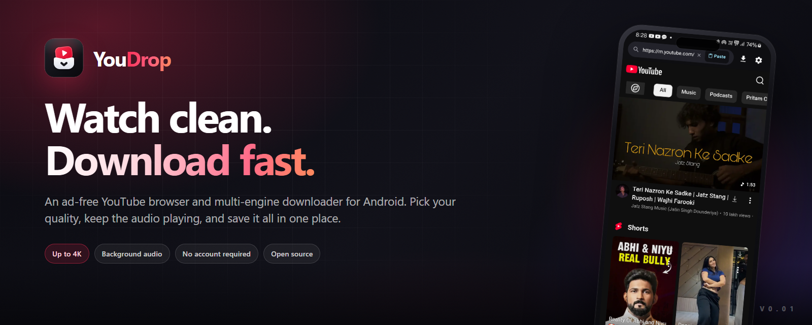
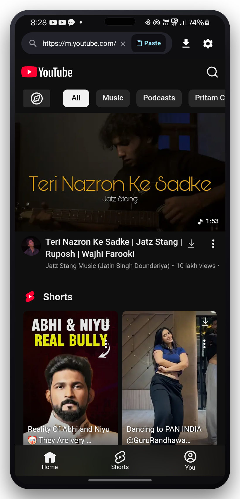

<div align="center">



<br />

**A private, ad-free YouTube browser and multi-engine downloader for Android.**

<a href="https://github.com/Mohammad-Shahid-07/vid_grab/releases/tag/v0.01">
  
</a>


<br /><br />

**Watch clean. Download fast. Keep everything.**

</div>

YouDrop pairs a focused YouTube browser with a serious download queue. Browse in a clean dark interface, block ads and trackers, keep audio playing in the background, then save any video or playlist in the quality you actually want.

No sign-up. No ad SDK. No analytics. No per-video quiz about which download engine to use.

> **Repository note:** the GitHub repository is still named `vid_grab` for continuity. The app is **YouDrop**.

---

## A look inside

<p align="center">
  
</p>

<p align="center">
  <sub>The built-in YouTube browser, with download actions injected exactly where you need them.</sub>
</p>

---

## Why YouDrop?

Most downloaders make you choose between speed, quality, and reliability. YouDrop runs a fallback chain instead: the fast path first, the compatibility path second, and a bundled yt-dlp engine when a stream needs more persuasion.

The browser is part of the app, not a bolted-on WebView. Download buttons appear on videos, Shorts, and playlists. Your queue keeps running in the background, and files land in a normal public folder that every gallery and music app can see.

| **Browse** | **Download** |
| :--- | :--- |
| **Ad & tracker blocking** built into the WebView, with a switch in Settings. | **Video or audio only** with a dedicated picker for each mode. |
| **Background audio playback** keeps the stream alive when the screen is off. | **Up to 4K** when the source provides it, with 1080p, 720p and lower presets ready. |
| **Share to YouDrop** from YouTube, a browser, or any app that shares links. | **Codec, container and audio-track control** before the download starts. |
| **Dark, distraction-free UI** with multiple themes and accent tones. | **Playlist batches** with item selection, ordering and optional numbering. |
| **Paste and search** without leaving the app. | **Pause, resume and retry** without throwing away downloaded bytes. |

### Built for real downloads

- **Three-stage engine fallback.** Fast segmented range downloads, then the NewPipe/DirectJVM path, then bundled yt-dlp with FFmpeg.
- **Global engine choice.** Pick Fast or Compatibility once; running downloads keep the engine they started with.
- **1-5 parallel downloads.** Two or three is the sweet spot for most connections.
- **Resumable queue.** Partial files and completed segments are reused after a pause, a dropped connection, or an app restart.
- **MediaStore export.** Videos go to `Download/YouDrop`, audio to `Music/YouDrop`, and every file is indexed for other apps.
- **Foreground progress.** Long downloads use a foreground worker and a notification, even when the app is in the background.
- **Battery-optimization shortcut.** One tap from Settings for OEMs that aggressively kill background work.

---

## Install

### Direct APK (recommended)

1. Open the [**v0.01 release**](https://github.com/Mohammad-Shahid-07/vid_grab/releases/tag/v0.01).
2. Download the APK that matches your device, or grab the universal build if you are unsure.
3. Open the downloaded file and allow **Install unknown apps** for your browser or file manager when prompted.
4. Launch **YouDrop** and grant the notification permission so progress stays visible.

| Device | Recommended APK | Approx. size |
| :--- | :--- | ---: |
| Most Android phones from the last several years | [**arm64-v8a**](https://github.com/Mohammad-Shahid-07/vid_grab/releases/download/v0.01/YouDrop-v0.01-arm64-v8a.apk) | 62 MB |
| Older 32-bit ARM phones | [**armeabi-v7a**](https://github.com/Mohammad-Shahid-07/vid_grab/releases/download/v0.01/YouDrop-v0.01-armeabi-v7a.apk) | 55 MB |
| Emulators, x86 Chromebooks and some tablets | [**x86_64**](https://github.com/Mohammad-Shahid-07/vid_grab/releases/download/v0.01/YouDrop-v0.01-x86_64.apk) | 64 MB |
| One build for every supported device | [**universal**](https://github.com/Mohammad-Shahid-07/vid_grab/releases/download/v0.01/YouDrop-v0.01-universal.apk) | 215 MB |

All builds are signed with the same release key. SHA-256 checksums are published as [`SHA256SUMS.txt`](https://github.com/Mohammad-Shahid-07/vid_grab/releases/download/v0.01/SHA256SUMS.txt).

> Android 10 (API 29) or newer is required. The APK is large because it bundles Python, yt-dlp, FFmpeg, aria2c and QuickJS for on-device extraction and merging.

### First launch checklist

- **Notifications** — required for live download progress on Android 13+.
- **Battery optimization** — exempt YouDrop if your phone kills long background jobs.
- **Download engine** — leave it on **Fast** unless a specific video refuses to finish.
- **Storage** — downloads are saved to `Download/YouDrop`; audio-only files can go to `Music/YouDrop`.

---

## How to download something

1. **Open the browser.** YouDrop starts on the YouTube mobile site.
2. **Find a video.** Search, paste a URL, or share a link from another app into YouDrop.
3. **Tap the download action.** It appears on the video page, in the Shorts feed, and on playlist items.
4. **Choose your format.** Pick Video or Audio, then select quality, codec, container and an audio track when the source offers one.
5. **Start the download.** Open **Downloads** to watch progress, pause, resume, retry or clear finished items.
6. **Find the file.** Videos are exported to `Download/YouDrop`; audio to `Music/YouDrop`.

For playlists, YouDrop opens a batch sheet where you can deselect items, reorder them, and add `01`, `02` numbering before starting the queue.

---

## Three engines, one decision

YouDrop never asks you to pick an engine for each video. Choose once in **Settings → Download Engine**:

- **Fast** — parallel segmented range downloads for the best speed on healthy connections.
- **Compatibility** — the older NewPipe/DirectJVM path, slower but better at unusual streams and containers.

Behind that choice sits an automatic fallback chain: if the selected engine fails, the other native engine is tried, then yt-dlp. A download that started on one engine stays on it when resumed, so partial files are never silently restarted.

### New in v0.01: pause/resume that actually resumes

Pausing during the final merge could previously restart the transfer when you resumed. YouDrop now records the active engine and stage inside the task directory, then resumes with the same engine, session and partial files. Existing paused tasks from older builds are inferred from their sandbox files.

---

## Build from source

### Requirements

- **JDK 17**
- **Android SDK 35** (compile SDK 35, target SDK 35)
- **Android Studio Ladybug** or newer, or the command-line SDK tools
- Windows, macOS or Linux

### Debug build

```bash
git clone https://github.com/Mohammad-Shahid-07/vid_grab.git
cd vid_grab

# Windows
.\gradlew.bat :app:assembleDebug

# macOS / Linux
./gradlew :app:assembleDebug
```

The universal debug APK is written to:

```text
app/build/outputs/apk/debug/app-universal-debug.apk
```

ABI-specific debug APKs are written next to it for `arm64-v8a`, `armeabi-v7a` and `x86_64`.

### Release build

```bash
cp keystore.properties.example keystore.properties
# Fill in your own keystore path and passwords, then:
./gradlew :app:assembleRelease
```

Release output:

```text
app/build/outputs/apk/release/app-universal-release.apk
app/build/outputs/apk/release/app-arm64-v8a-release.apk
app/build/outputs/apk/release/app-armeabi-v7a-release.apk
app/build/outputs/apk/release/app-x86_64-release.apk
```

`keystore.properties` is git-ignored. If it is absent, the release build falls back to the Android debug key so local builds still work — do not publish those APKs.

---

## Under the hood

| Layer | What YouDrop uses |
| :--- | :--- |
| **UI** | Kotlin 2.1, Jetpack Compose, Material 3 |
| **State & storage** | Coroutines, Room, WorkManager (UIDT foreground jobs) |
| **Networking** | OkHttp, custom InnerTube client |
| **Extraction** | NewPipeExtractor, InnerTube, yt-dlp |
| **Media processing** | FFmpeg, Android MediaMuxer |
| **Browser** | Android WebView with injected download bridge and request filtering |

<details>
<summary><b>Project structure</b></summary>

```text
app/src/main/java/com/vidgrab/app/
├── core/
│   ├── engine/      # FastDirect, DirectJVM, yt-dlp, fallback and resume
│   ├── extractor/   # NewPipe + InnerTube metadata resolution
│   ├── webview/     # browser bridge, ad blocking, injected JavaScript
│   ├── storage/     # MediaStore export
│   ├── worker/      # queue worker and foreground notifications
│   └── queue/       # Room-backed download queue
└── ui/
    ├── browser/     # in-app YouTube browser
    ├── modal/       # quality and playlist picker
    ├── downloads/   # active and completed downloads
    └── settings/    # engine, themes, storage, battery
```

</details>

---

## Privacy

- **No account, no sign-in, no analytics, no crash reporting, no ad SDK.**
- WebView cookies and session data stay on your device.
- Downloads stay in local public folders until you delete them.
- Network traffic goes to YouTube/Google and the media CDN endpoints needed to browse and download. YouDrop does not send usage data to a project server.

YouDrop is a client. It does not host, mirror, or upload media.

---

## Legal

YouDrop is an independent open-source project. It is **not affiliated with, endorsed by, or sponsored by YouTube, Google, or any content owner.**

Downloading content may violate a service's terms of use or copyright law in your country. Use YouDrop only for content you own, content licensed for download, or content you have explicit permission to save. You are responsible for how you use the app.

YouDrop is distributed under the **GNU General Public License v3.0**. See [LICENSE](LICENSE) and [THIRD_PARTY_NOTICES.md](THIRD_PARTY_NOTICES.md) for the full text and dependency attributions.

---

<div align="center">

**If YouDrop saves you time, leave a star on the repo.**

<sub>Built with Kotlin, Jetpack Compose, NewPipeExtractor, yt-dlp and the youtubedl-android project.</sub>

</div>
